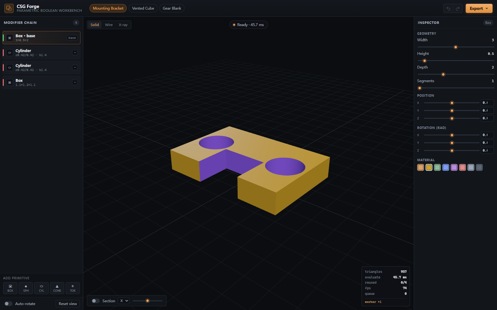

# CSG Forge

**把「布尔建模」从卡住页面的同步调用，变成不阻塞主线程的参数化工作台。**

上游 [three-bvh-csg](https://github.com/gkjohnson/three-bvh-csg) 是一个高质量的 CSG 库，但它的 Worker 支持一直停留在 Roadmap 上 —— `src/workers/` 里只有两个空类。本项目把这两个空类实现成真正的 Worker 池，并在此之上做出一个可交互的参数化布尔建模工作台。

> 上游：`gkjohnson/three-bvh-csg` · MIT · 0.0.18 · 完整提交历史保留
> 上游 README 保留在 [`README.upstream.md`](README.upstream.md)，未改动。



---

## 1. 上游留下的空白（可验证）

三处证据，全部来自上游自己的文件：

**① README 的 Roadmap**

```
# Roadmap / Help Wanted
- Worker Support [#14](https://github.com/gkjohnson/three-bvh-csg/issues/14)
```

**② `IMPLEMENTATION.md` 的自述**

> `src/workers/*`
> **Currently unused.**

**③ 实际代码 —— 两个空类**

```js
// src/workers/AsyncEvaluator.js  @ upstream main
export class AsyncEvaluator {

}
```

```js
// src/workers/Pool.js  @ upstream main
export class Pool {

}
```

也就是说：上游把 Worker 化列进了路线图、留了目录、写了文件名，但一行实现都没有。本项目的全部工作就是填这个洞。

## 2. 做了什么

### 2.1 四个模块，1256 行

| 文件 | 行数 | 职责 |
|---|---|---|
| `src/workers/protocol.js` | 271 | 线协议。three.js 对象不可结构化克隆，所以每个 brush 先序列化成 `{geometry, matrixWorld, material}` 描述符；几何用 `ArrayBuffer` 零拷贝转移；`fnv1a` 指纹用于判断"这个 brush 变了没" |
| `src/workers/csg.worker.js` | 289 | 模块 worker。**原封不动地跑上游 `Evaluator`**，外面套两层缓存 + 三个探针消息 |
| `src/workers/Pool.js` | 391 | 工作池。任务队列、每 worker 独立状态、AbortSignal、空闲回收、销毁 |
| `src/workers/AsyncEvaluator.js` | 305 | `Evaluator` 的 Promise 版。`evaluate()` 与上游同签名（加 `await`），另加 `evaluateChain()` |

### 2.2 三个关键设计

**① 上游 `Evaluator` 一行没改，直接跑在 worker 里**

`csg.worker.js` 里 `import { Evaluator } from '../core/Evaluator.js'` —— 用的是上游原版。所有优化都在外层，好处是上游修 bug 时直接受益，不需要同步两份 CSG 实现。

**② 两级缓存，让"改最后一个参数"变成增量计算**

```
brushCache  按 (id, fingerprint) 缓存序列化后的 brush
stageCache  缓存链式求值的每一级中间结果 nodes[0..i]
```

编辑链尾节点时，前 N-1 级的结果直接命中 `stageCache`，只重算最后一级。实测 4 节点链热路径复用 **3/4** 级。

这个缓存只有配合 worker 才有意义 —— 否则省下的计算量还不如跨线程传输成本。

**③ 无 Worker 环境自动降级**

`Worker` 不存在时（Node、受限 iframe、SSR）`AsyncEvaluator` 走同步路径，用 microtask 包装成 Promise。调用方永远只有一套代码。

```js
const evaluator = new AsyncEvaluator({ workers: 2 });
const { brush, stats } = await evaluator.evaluateChain(nodes);
// stats: { totalMs, resolveMs, solveMs, reusedStages, triangles }
```

### 2.3 工作台（2760 行）

不是 demo 页，是能干活的东西：

| 区域 | 能力 |
|---|---|
| Modifier chain | 线性修改器栈，每级可选 Union / Subtract / Intersect / Difference（四色编码），增删、选中、拖序 |
| 图元 | Box / Sphere / Cylinder / Cone / Torus，参数化（尺寸、分段数） |
| Inspector | 选中节点的全部参数滑块、变换（位置/旋转/缩放）、材质颜色 |
| 视口 | Solid / Wireframe / X-ray 三模式、剖切平面（轴向 + 偏移）、自动旋转、轨道控制 |
| HUD | 三角形数、求值耗时、前缀复用级数、fps、队列深度、worker 数量 |
| 导出 | glTF Binary (.glb) / STL Binary (.stl) / Wavefront OBJ (.obj) / 工程 JSON |
| 历史 | 撤销 / 重做，滑块拖动合并为一条记录 |
| 预设 | Mounting Bracket（4 节点）/ Vented Cube（4 节点）/ Gear Blank（13 节点） |
| 响应式 | ≥1180 三栏 / 860–1180 收窄 / <860 单栏 + 底部 sheet 切换 |

## 3. 实测数据

环境：headless Chromium（系统 Edge），1600×1000，SwiftShader 软件渲染，Windows 11。全部来自 `docs/shots/bench.json`，可用 `npm run bench` 复现。

**同一条 4 节点链，同一台机器，主线程 vs Worker（12 轮热路径）：**

| 指标 | Worker | 主线程 (sync) | 差值 |
|---|---|---|---|
| 冷路径单次往返 | 55.1 ms | 24.6 ms | Worker 慢 2.2× |
| **热路径单次往返** | **14.7 ms** | **24.0 ms** | **Worker 快 1.63×** |
| 热路径求解耗时 | 12.8 ms | 23.9 ms | — |
| 主线程最大卡顿（冷） | 18.5 ms | 32.2 ms | **省 13.7 ms** |
| 主线程最大卡顿（热） | 16.3 ms | 32.4 ms | **省 16.1 ms** |
| 帧间隔均值（热） | 14.6 ms | 22.9 ms | — |
| **主线程阻塞帧数** | **0 / 16** | **2 / 12** | — |
| 前缀复用 | 3/4 | 不支持 | — |
| 一次性启动开销 | 199.4 ms | 0 | — |

**怎么读这组数字：**

- **冷路径 Worker 更慢是必然的**，不是缺陷。每个 brush 第一次都要跨线程传输，`coldTimeRatio = 0.45` 精确地说明了这一点。诚实结论：**单次求值用 worker 是亏的。**
- **热路径反超 1.63× 才是这个项目的价值**，但功劳不在"多线程"，而在 `stageCache` 前缀复用 —— 编辑链尾时只重算 1 级而不是 4 级。worker 只是让这个增量计算不占主线程。
- **阻塞帧 0 vs 2** 是用户真正能感知的差别。主线程模式下 12 帧里有 2 帧被 30ms 级的求解卡住，交互会掉帧；worker 模式下 16 帧一次都没卡。
- **199ms 启动开销**是一次性的，只在第一次求值时支付。

> 这些数字**没有取最好值**。冷路径对 worker 不利的结论、启动开销、以及"热路径优势来自缓存而非并发"这三点都写在上面。

## 4. 快速开始

```bash
npm install
npm run start          # http://localhost:5173/workbench.html
```

构建静态产物：

```bash
npm run build-examples # 输出到 examples/bundle/
```

上游原有的 8 个示例页（`coplanar` / `geometry` / `hierarchy` / `hollow` / `multimaterial` / `multiop` / `debug` 等）在同一服务器上照常可访问，未受影响。

## 5. API

### 5.1 即插即用（与上游 `Evaluator` 同签名）

```js
import { AsyncEvaluator } from 'three-bvh-csg/workers/AsyncEvaluator.js';
import { Brush, Evaluator, SUBTRACTION } from 'three-bvh-csg';

const evaluator = new AsyncEvaluator({ workers: 2 });
const result = await evaluator.evaluate(brushA, brushB, SUBTRACTION);
```

### 5.2 链式求值（带前缀缓存）

```js
const { brush, stats } = await evaluator.evaluateChain([
  { brush: base },
  { brush: hole1, op: SUBTRACTION },
  { brush: hole2, op: SUBTRACTION },
]);
// stats.reusedStages === 2 表示前两级命中缓存
```

### 5.3 取消

```js
const controller = new AbortController();
evaluator.evaluateChain(nodes, { signal: controller.signal });
controller.abort();   // 队列中未开始的任务直接丢弃
```

### 5.4 强制同步（用于测试或无 Worker 环境）

```js
const evaluator = new AsyncEvaluator({ forceSync: true });
evaluator.mode; // 'sync'
```

## 6. 测试与验收

```bash
npm test          # 65 passed | 2 todo
npm run verify    # 13 张截图 + 12 项交互断言 + 像素统计
npm run bench     # 主线程 vs worker 对比，写 docs/shots/bench.json
```

| 套件 | 数量 | 覆盖 |
|---|---|---|
| 单元测试 | **65**（上游 31 + 新增 34） | 上游 CSG 核心回归 + 协议往返/指纹/转移列表 + 池调度/取消/回收 + AsyncEvaluator 双模式一致性 |
| 验收脚本 | 13 张截图 | 加载零错误、DOM 几何、canvas 像素解码、预设/图元/选中/参数/模式/剖切/撤销/四种导出/三种视口/移动端 sheet |

**上游兼容性**：上游原有的 31 个测试全部通过（`CSG.Evaluator` / `CSG.ResultVolume` / `HalfEdgeMap` / `TriangleSplitter` / 各 Utils）。`src/core`、`src/objects`、`src/materials`、`src/utils`、`src/libs` 一行未改。

**视觉验收方式**：当前模型读不了图，所以验收不靠"看起来没问题"。截图用 PNG 逐像素解码，背景色从四角估计，统计非背景占比、暖冷色比、亮度动态范围、调色板规模。关键断言：

- canvas 非背景占比 **14.75%**（初始视口），动态范围 **221**（有明暗层次），调色板 **338** 色 → 不是空白也不是纯色块
- Wireframe 的墨迹（9.93%）显著低于 Solid（12.49%）→ 模式真的切换了
- 开启剖切后墨迹从 12.49% 降到 8.01% → 剖切真的在切
- 三个预设的三角数分别为 957 / 1898 / 2012 → 预设真的换模型了

## 7. 已知限制

1. **单次求值不值得用 Worker**。冷路径慢 2.2×，199ms 启动开销。只有当你在连续编辑（拖滑块、改参数）时热路径缓存才回本。
2. **前缀缓存只支持线性链**。`evaluateChain` 处理的是 `base → op → op → op` 的线性栈，不支持树状/嵌套 CSG 图（上游 `OperationGroup` 那种）。树状结构需要按子树做记忆化，尚未实现。
3. **序列化有成本**。`position` / `normal` / `uv` 三个属性全量传输，大模型（>20 万三角形）时传输开销会盖过求解收益。指纹机制避免了重复传输，但首次仍需全量。
4. **SwiftShader 下的 fps 不代表真机**。headless 软件渲染 1600×1000 + 1024² 阴影贴图，fps 只有个位数。这个数字只在横向对比时有意义。
5. **上游的数值鲁棒性问题依然存在**。三角形分割的边角情况（issue #73 / #68）属于上游算法层，本项目没有触及。

## 8. 许可与署名

- 上游代码：MIT © 2022 Garrett Johnson，`LICENSE` 保持原文未改
- 新增代码：MIT，完整清单见 `NOTICE`
- 本项目不是上游官方分支，与上游维护者无隶属关系

---

## English summary

**CSG Forge** implements the Worker support that three-bvh-csg lists on its roadmap but never wrote — `src/workers/` shipped two empty classes.

- **`protocol.js`** — brush descriptors, zero-copy `ArrayBuffer` transfer, FNV-1a fingerprints so unchanged brushes never cross the boundary twice.
- **`csg.worker.js`** — hosts the *unmodified* upstream `Evaluator`, plus a two-level cache (`brushCache` per brush, `stageCache` per chain prefix).
- **`Pool.js`** — task queue, per-worker state, `AbortSignal`, idle recycling.
- **`AsyncEvaluator.js`** — Promise mirror of `Evaluator`, plus `evaluateChain()` with prefix reuse; degrades to a synchronous microtask path when `Worker` is unavailable.
- **Workbench** — modifier chain with four boolean ops, five parametric primitives, section plane, three display modes, glTF/STL/OBJ/JSON export, undo/redo, responsive down to 430px.

**Measured honestly** (12 rounds, same chain, same machine): cold path is **2.2× slower** on the worker (55.1 vs 24.6 ms) because every brush must cross the boundary; the hot path is **1.63× faster** (14.7 vs 24.0 ms) — and that win comes from `stageCache` prefix reuse, not from concurrency. Main-thread stalls drop from 32.4 ms to 16.3 ms, and blocked frames from 2/12 to 0/16.

**Tests**: 65 passing (31 upstream + 34 new). Upstream `src/core` is untouched.

MIT. Upstream © Garrett Johnson. Not an official fork.
